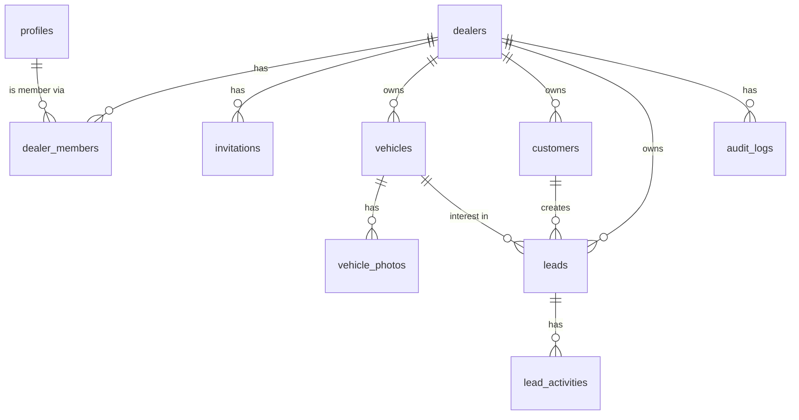

# Autonexus — Data Model

All tenant tables carry `dealer_id` and are protected by RLS
(see [SECURITY.md](./SECURITY.md)). Migrations live in `supabase/migrations/`.

## ERD (MVP scope)

## Tables

### `dealers` — tenant root
| column | type | notes |
|---|---|---|
| id | uuid PK | |
| name | text | dealer trading name |
| slug | text unique | for widget/public pages later |
| plan | enum `starter\|professional\|dealer_group` | feature gating |
| created_at | timestamptz | |

### `profiles` — 1:1 with `auth.users`
id (uuid PK = auth.users.id), full_name, phone, avatar_url, created_at.
Created automatically by trigger on signup.

### `dealer_members` — membership + role
| column | type | notes |
|---|---|---|
| dealer_id | uuid FK | PK part |
| user_id | uuid FK | PK part |
| role | enum `owner\|admin\|sales\|agency` | per-dealer role; `agency` = our marketing team, marketing-only scope |
| status | enum `active\|suspended` | |
| invited_by | uuid | |
| created_at | timestamptz | |

### `invitations`
id, dealer_id, email, role, token_hash (single-use), expires_at (7 days), accepted_at,
invited_by, created_at.

### `vehicles`
| column | type | notes |
|---|---|---|
| id | uuid PK | |
| dealer_id | uuid FK | |
| make / model | text | |
| year | int | |
| km | int | |
| fuel | enum `petrol\|diesel\|hybrid\|electric\|other` | |
| transmission | enum `manual\|automatic` | |
| buy_price | numeric | hidden from `sales` role |
| sale_price | numeric | |
| status | enum `bought\|preparation\|ready_for_sale\|reserved\|sold` | |
| nct_expiry | date | Ireland-specific |
| warranty_months | int | |
| description | text | AI-generated ad text stored here |
| created_by | uuid | |
| created_at / updated_at | timestamptz | |

Margin = `sale_price - buy_price` (computed, not stored).

### `vehicle_photos`
id, vehicle_id, dealer_id, storage_path (`{dealer_id}/{vehicle_id}/...`), position,
is_cover, created_at.

### `customers`
id, dealer_id, name, email, phone, notes, gdpr_consent_at, deleted_at (soft delete),
created_at.

### `leads`
| column | type | notes |
|---|---|---|
| id | uuid PK | |
| dealer_id | uuid FK | |
| customer_id | uuid FK nullable | |
| vehicle_id | uuid FK nullable | |
| source | enum `website\|donedeal\|facebook\|instagram\|whatsapp\|walk_in\|phone\|other` | |
| stage | enum `new\|contacted\|appointment\|test_drive\|finance_applied\|sold\|after_sales\|lost` | |
| score | enum `hot\|warm\|cold` nullable | Stage 2: auto-scored |
| assigned_to | uuid nullable | salesperson |
| notes | text | |
| created_at / updated_at | timestamptz | |

### `lead_activities`
id, lead_id, dealer_id, type (`note|call|email|whatsapp|status_change|ai_reply`), body,
created_by, created_at.

### `audit_logs`
id, dealer_id, user_id, action, entity, entity_id, meta (jsonb), created_at.
Insert-only.

## Future tables (per roadmap stage)

- **Stage 1 (Marketing & AI Studio core):**
  - `brand_kits` — dealer_id, logo_path, colors jsonb, fonts, tone_of_voice,
    logo_placement (position/size/opacity/frame), custom_fields jsonb.
  - `description_templates` — dealer_id, name, kind (`warranty|finance|hours|trade_in|custom`),
    body, is_default, position.
  - `ad_creatives` — dealer_id, vehicle_id, source_photo_path, enhanced_photo_path,
    channel (`donedeal|facebook|instagram_feed|instagram_story|google`), status
    (`processing|ready|published`), enhancement_meta jsonb (what the AI changed —
    audit that reality was preserved).
  - `generated_descriptions` — dealer_id, vehicle_id, channel, title, body, hashtags,
    template_ids used.
- **Stage 2:** `social_posts` (platform, caption, media refs, scheduled_at, status),
  `agency_grants` (dealer_id, granted_by, team_member_id, scope, granted_at,
  revoked_at — backs the one-click agency access), `lead_messages`, `auto_reply_templates`.
- **Stage 3:** `campaigns` (platform, objective, budget, metrics jsonb), `ad_accounts`
  (OAuth tokens — encrypted), `widget_configs`.
- **Stage 4:** `finance_applications` (encrypted PII columns), `service_reminders`, `reviews`.
- **Stage 5:** `subscriptions` (Stripe), `listings_sync` (DoneDeal/Carzone state), `usage_events`.
