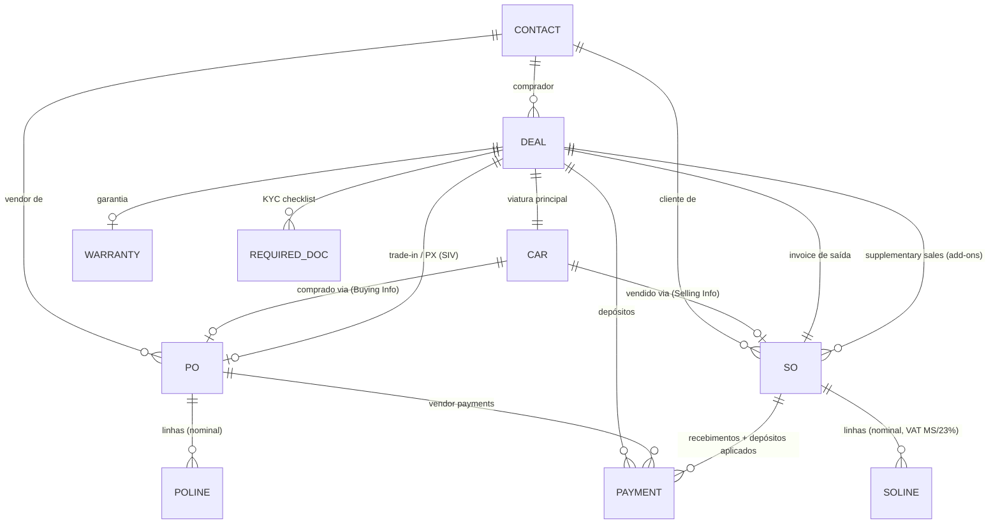

# GarageManager.ie — Análise do sistema (recon só‑leitura)

> Levantamento feito no CRM do dealer (National Motors) em 2026‑09‑13, **apenas leitura** —
> nada foi criado, alterado ou apagado. Objetivo: perceber features, modelo de dados e a
> lógica de criação de **Deal, PO, SO, Car ID, Customer ID, Invoice, Agreement** para
> replicar/adaptar no Autonexus.

---

## 1. Visão geral & módulos de topo

Aplicação PHP multi‑site (ex.: "Unit 1"), com barra de topo:

| Menu | O que é |
|---|---|
| **Home** | Dashboard: CRM Planner (semana), Vehicle Stock por localização, Current Messages (changelog), Last Updates (Cars/Sales/Purchases/Payments) |
| **Clients** | Contacts (clientes+fornecedores), New contact, Car Interest, Groups, CRM |
| **Car Admin** | Cars (stock), Current Stock, To Be Invoiced, To Be PO'ed, Car Reports, Custom Reports |
| **Finance** | Purchases (PO), Sales (SO), Bank, Stock (peças), Reports, Accountant |
| **Marketing** | Contact Finder, Contacts, Bulk email, Groups, CRM |
| **Workshop** | Jobs / oficina |
| **Admin** | My Details, Images, Todo, Timeclock, Calendar, Database, Logout |

Escala real observada: **321 carros em stock (Unit 1)**, **1519 carros no total** na BD.

---

## 2. Entidades centrais & IDs

| Entidade | Identificador | Notas |
|---|---|---|
| **Contact** | `id` numérico (ex.: 1399) | Cliente **e** fornecedor unificados. De um contacto pode‑se "Buy Car", criar PO, criar SO, ver Accounts (extrato) |
| **Car / Vehicle** | `id` interno + **stock code `CAR-{id}`** (ex.: CAR‑1578) | A viatura física. Entra por compra (PO) ou manual |
| **Deal / Lead** | `deal_id` (ex.: 1378), rótulo `DEAL‑1378` | **Objeto guarda‑chuva** do negócio. Vive no CRM (`crm/display.php`) |
| **PO — Purchase Order** | `PO{n}` / `0{n}` (ex.: PO1880) | Compra de carro **ou** charge/serviço a um vendor |
| **SO — Sales Order / Invoice** | `SO#` interno + **Invoice # `YYMMDDNN`** (ex.: 26091202) | Venda a um cliente → fatura |
| **Payment / Deposit** | por linha | Alocado a Deal/SO/PO. Tipos: Cash, EFT [In Bank], Credit Card Machine, Finance |
| **Charge** | linha do carro | Custos extra (VRT, prep…) que viram POs, com nominal code |
| **Stock (peças/serviços)** | `Stock Code` | Catálogo separado dos carros, com classificações e Good/Service |
| **Nominal code** | ex.: 001 (venda carro), 111 (compra carro) | Base da contabilidade / General Ledger |

---

## 3. Relações (modelo)



Ligações concretas observadas: `Car 1578` → `PO1880` (compra, vendor contacto 1193) ·
`Deal 1378` → `Car 1049` + `SO1467` (Invoice 26091202) + 4 depósitos + cliente contacto 1399.

---

## 4. Ciclo de vida do **Deal** (a lógica‑chave)

O Deal é um **Lead do CRM** que progride por **etapas** (pipeline):

```
Initial contact → Vehicle interest → Test Drive → Proposal → Negotiation
  → Closing (depósito) → After sales service (Deal Finished)   [ou] Deal cancelled
```

Sequência de negócio real (do Event Log do Deal 1378):

1. **Lead criado** (Vehicle interest).
2. **Agreement printed** — regista `Customer Price`, `SIV Total`, `Cost to Change`.
3. **Deposit(s) taken** — vários depósitos (CC/EFT), cada um logado.
4. **Invoice (SO) criado** — "Deal finished, created SO: 1467".
5. **After sales service** — pós‑venda.

Matemática do Deal:
- **Retail Price** (preço ao cliente)
- **SIV** = Settlement/Trade‑In Value (valor da viatura de troca)
- **Cost to Change** = Retail Price − SIV (o que o cliente paga líquido da troca)
- **Payments/Deposits** (soma dos depósitos)
- **Balance To Pay** = Cost to Change − Payments

Blocos do Deal:
- **Contact Info** (nome, email, phone/mob, Referred By, **Assigned To** = vendedor, Current Status)
- **Steps** (timeline de etapas com nota + data + autor)
- **Deal Paperwork** (tabela Type/Ref/Status/Description/Amount/Balance → Invoice=SO, PX=PO, Finance…)
- **Vehicle** (viatura a vender, link para o Car)
- **Warranty** (setup por deal)
- **Payments** (depósitos)
- **Supplementary Sales** (add‑ons vendidos como SOs extra, com Profit)
- **Money Details** (Retail / To Change / Payments / Balance)
- **Terms**, **Quote Printed**, **Agreement Printed** (timestamps)
- **Required Documents** (KYC): Drivers License (frente/verso), Utility bill, Trade‑in VRC/logbook — Recebido Sim/Não
- **Event Log** (auditoria: quem, quando, o quê — depósitos, agreement, etc.)

---

## 5. Ficha do carro (`cars/display_car.php?id=`) — igual à referência

**Cabeçalho**: Make/Model, ID interno, Asking/Window Price, Odometer (Mi+Km, original), Year,
1st Reg Date + jurisdiction, Reg (placa), Tax (validade + valor anual), NCT'ed, Fuel/Trans,
Body, Colour, CO2, Engine Size, Chassis No, GVW, Engine #, Body Length, Service History,
Display on Web? (yes/no + Featured), # of Owners, **Deal ID**, **Car Source** (Trade purchase…),
On NFD, Yard, **Stock Class** (Main Stock / Trade), Days in Stock, Location, **Type** (Retail List), Tags.

**Buying Info**: Purchase Price · Bought From (contacto) · Bought By (staff) · [Buy car] · RF105 ·
tabela de PO(s) (Ref/Date/Vendor/Status/Stock No/Description/Amount) · Total Costs · Bought Date ·
Collected On · **VAT Type** (Marginal/Special Scheme | Standard).

**Selling Info**: botão **"Sell this car!"** (`sell_car.php?id=`) → inicia a venda/SO.

**Extra Info**: Keys (Master/Spare/ID Cards/Remotes), VRT Category, Key Peg Ref, HP Check,
VLC Status/Number, Motortrans In/Out, Yard, Repair Notes, Notes.

**Photos**, **Date Information** (Created/Updated By + On).

Ações: Edit, Window Sign, Asset Tag, Loan/Ext Repair, Hold, Checks, Label, Create Event,
Create Workshop Request, Edit purchase, Charges, Tags.

---

## 6. PO — Purchase Order (`pop/po_overview.php?id=`)

Campos: **PO Ref #**, PO Date, **Inv Ref** (nº fatura do fornecedor), Invoice Date,
**Order Status** (`PO to be paid` → aprovação → `Paid`), Paid Date, **Ordered From** (vendor) + PO Address,
Created/Updated/Printed by, Site, **Payments** (Amount/Date/Ref/Type) + Balance to be paid + Amount outstanding.

Linhas: Qty · **Stock Code** (CAR‑1578) · **Assigned** (`*CAR:1578` → link ao carro) · **Nom Code** (111) ·
Description (multi‑linha: modelo/reg, chassis, distância, cor) · Unit RRP · Net · VAT · Gross.

Ações: New, Edit Header, Copy, Print (`make_po.php`), Explain VAT, Remove, **Nom Codes**,
**View Ledgers** (general_ledger), **Re‑edit PO** (muda status), **Make a payment**
(`make_vendor_payment.php?vendor_id=&po_id=`), **Create Credit Note**.

> Nota do changelog: existe **"PO approval process"** — POs têm de ser **aprovados antes do pagamento**.

---

## 7. SO / Invoice (`sop/so_overview.php?id=`)

Campos: **SO #** interno + **Invoice #** (YYMMDDNN), Invoice Date, Paid Date,
**Order Status** (`Fully Paid` / `Waiting Payment`), PO Number (opcional),
**Invoice To / Shipping To** (+ Company + Address completo com telefone + eircode),
**Payments** (linha da fatura +valor, e **depósitos aplicados** −valor, cada um com tipo),
Balance Due, Order/Invoice Notes.

Linhas: **Stock Code** (CAR‑1049) · link **DEAL‑1378** · **Nom** (001) · Description (modelo/reg/chassis
+ sub‑linhas Distance/Colour) · Net · **VAT** (`MS` = marginal scheme) · Gross · edit/del · "Add Comment Line".

**VAT Liability**: Vat Rate (23% [**] = marginal/special), Net Amount, VAT. Sub Total / Invoice Total.
Extra Info: Created/Updated/Printed by, VAT Paid On, Terms, controlo de Credit Control emails.

Ações: Edit Header, **Print Inv**, **Email Invoice**, Push To Terminal, **Explain VAT**, **View Ledgers**.

---

## 8. Contact / Cliente (`contacts/display.php?id=`) — igual à referência

Campos: Contact (Título+Nome, ID), Main Phone, **DDI**, Mobile, **Fax**, Email, Website,
**Marketing Consent** (Not asked/…), Address, County, Town, Post Code, Location (map), Country,
Free Notes, Groups, Tags, **VAT Number**, **Company Reg #**, **TAN Number**, Garage Code,
Account Ref, **Source**, **Sales Terms** (X dias de crédito), Date Information.

Ações do contacto: **Buy Car** (`buy_car.php?bfid=`), **Create PO** (`pop/edit.php?cid=`),
**Create SO** (`sop/edit.php?cid=`), Add to Group, History, **Accounts** (`account_summary.php` = extrato
debtor/creditor), Add Note, XML, VLC Report.

O formulário "Search or Create New Contact" (mostrado no fluxo de venda) tem: Company Name, Title,
First/Last Name, Job Title, **Data Consent**, Main Phone, DDI Phone, Fax, Mobile, Email, Address,
Town, County, Post Code, Country (IE‑Ireland).

---

## 9. VAT (Irlanda)

- **Marginal / Special Scheme (`MS`)** — VAT sobre a **margem** (usado em usados qualificados).
- **Standard 23%** — VAT sobre o preço.
- Cada SO mostra **VAT Liability** (rate/net/vat) e um **"Explain VAT"**.
- **ROS XML Returns** (`finance_reports/ros_xml_admin.php`) — declarações VAT para o Revenue Online Service.
- Nominal codes + General Ledger dão a base contabilística.

---

## 10. Contabilidade (`accountant/`)

Admin: **Nominal Codes**, **General Ledger**, **Dyn Ledger**, **Brexit Area**.
**Audit Reports**: Trial Balance (período), **P&L** + P&L Windowed, **Aged Creditors** (POs por pagar),
**Aged Debtors** (SOs por receber), Stock Report, Payments Report.
**Outros**: PO Report, **Money Out**, SO Report, **Money In**, **Vehicle Movement**.

---

## 11. Relatórios

- **Car Reports**: Invoiced but in stock (`cars_with_no_invoice.php`), **VLC Report**, **Vehicle Checks**.
- **Custom / Management**: **Charges Report**, **Detailed Sales Report** (Sold On), Months Cars (v2)
  baseado em **Sold/Bought/Paid**, por Bought‑From/Sold‑To.
- **Finance Reports**: **SOs — Waiting Payment**, **POs — To pay**, ROS XML.
- Atalhos de stock: **To Be Invoiced** (`so_status=n`), **To Be PO'ed** (`po_status=n`), **Current Stock**.

---

## 12. Outros módulos

Workshop (jobs/pedidos ligados ao carro), Stock de **peças/serviços** (classificações: Body & Exhaust,
Brakes, Cooling & Heating, Electrical & Lighting, Engine Parts, Lubricants, Service Parts, Suspension &
Steering, Tools, Transmission, Tyres, Valet; Good vs Service; Vat Admin; price update),
Marketing (Bulk email, Groups, Contact Finder), Car Interest (wishlist do cliente ↔ stock),
CRM Planner (semana), **74 Unassigned Deposits** (depósitos por alocar), Calendar, Todo, Timeclock,
Image store, Bank, **Stocking Finance** (financiamento de stock, no changelog).

---

## 13. Service Agreement (gate de login)

No login, o sistema mostra `personal/agreement.php` — **Terms of Service** com:
- Botão **"I Agree"** → `agreement_handler.php` (regista aceitação)
- Botão **"I Don't Agree"** → `logout.php`

O texto completo (A. General Terms 1–15 + B. Additional Terms 1–6: Subscription, Beta Features,
Permitted Disclosures, Online Data Transfer, Service Use/Storage/Access, Cancellation) foi capturado.
Serve de base para o nosso próprio ecrã de aceitação de termos (ver roadmap §"Service Agreement").

---

## 14. Mapa de rotas (referência)

| Função | Rota |
|---|---|
| Ficha do carro | `cars/display_car.php?id=` |
| Busca/stock de carros | `cars/search.php?stock_status=in_stock` · `?so_status=n` (a faturar) · `?po_status=n` (a PO'ar) |
| Vender carro (→ SO) | `cars/sell_car.php?id=` |
| Comprar carro (→ PO) | `cars/buy_car.php?bfid={contactId}` |
| PO overview / novo / editar | `pop/po_overview.php?id=` · `pop/new.php` · `pop/edit.php?cid=` |
| PO — a pagar / sem fatura | `pop/po_to_be_paid.php` · `pop/pos_with_no_invoice.php` |
| SO overview / novo | `sop/so_overview.php?id=` · `sop/edit.php?cid=` · `sop/search_so.php?so_status=wp` |
| Deal / Lead (CRM) | `crm/display.php?deal_id=` · lista `crm/` |
| Contacto | `contacts/display.php?id=` · `contacts/edit.php` · `contacts/account_summary.php?id=` |
| Contabilidade | `accountant/` · `accountant/general_ledger/` · `accountant/nominal_codes/` |
| Relatórios | `reports/` · `reports/custom/` · `finance_reports/` |
| Pagamento a vendor | `pop/make_vendor_payment.php?vendor_id=&po_id=` |
| Depósitos por alocar | `crm/unalloc-depos.php` |
